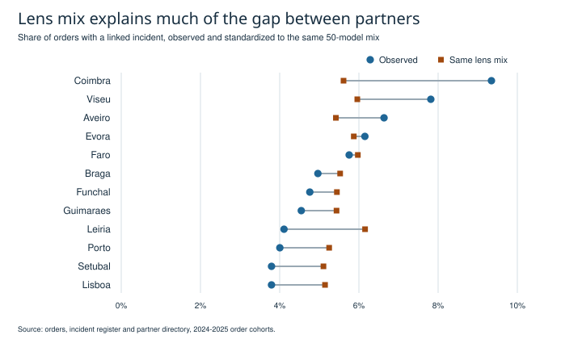
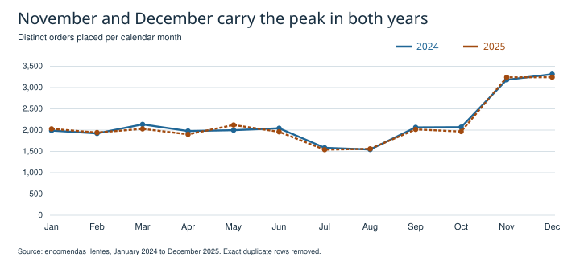

# Lens operations | 2024–2025

**Analysis date · 25 November 2026**  
**Scope · 51,374 distinct orders, 70,305 lenses, 12 partner opticians, 50 lens models**

Twelve high-complexity progressive models account for one-third of orders and four-fifths of estimated incident cost linked to orders. Their concentration in particular shops explains much of the apparent gap in partner performance. For capacity planning, the clearest signal is the calendar: in both years the network received about 106 orders per day in November–December, more than double the July–August pace.

## Where the quality cost concentrates

An **affected order** has at least one matching record in the rework and returns register. The denominator includes every distinct order placed during 2024–2025. Costs below are sums of incident estimates, expressed in the source's monetary units. The files do not specify a currency.

| Lens group | Orders | Affected orders | Affected share | Linked incident cost | Mean production hours per order |
|---|---:|---:|---:|---:|---:|
| L001–L012 · progressive, complexity 4–5 | 17,259 | 1,804 | 10.45% | 394,126.10 | 6.78 |
| L013–L020 · progressive, complexity 2–3 | 7,110 | 208 | 2.93% | 17,463.34 | 5.44 |
| All 30 models in the other four categories | 27,005 | 894 | 3.31% | 76,397.31 | 4.91 |
| **Network** | **51,374** | **2,906** | **5.66%** | **487,986.75** | **5.61** |

The first 12 models had **3.24 times** the affected-order rate of the remaining 38 models, a difference of **7.22 percentage points**. The pattern held within every partner, in 2024 (10.72% versus 3.23%) and in 2025 (10.18% versus 3.23%). Removing any one partner gave a rate ratio between 3.15 and 3.30. Grouping all progressives together would obscure the much lower rate for L013–L020. Complexity, design and model identity overlap here, so their separate contributions are uncertain.

**L001 is a practical starting point for a case review.** It had 183 affected orders out of 1,488 (12.30%) and 39,953.69 in linked incident cost. Across the full register, returns generated the largest total estimate (194,739.58 across 952 events), narrowly exceeding rework (189,858.60 across 1,494). Replacements were the most expensive per event (261.82 across 460). The remaining 295 adjustments averaged 43.01.

The register contains 3,201 events costing 517,723.44 in total. Of these, 3,016 events matched 2,906 orders, including 109 orders with multiple events. The 185 unmatched events account for 29,736.69. Their lens IDs still resolve to the catalogue. Including them by recorded lens gives L001–L012 **80.7%** of all estimated incident cost, close to the **80.8%** from linked orders alone.

## How much of the partner gap is lens mix?

Coimbra recorded the most orders (7,008), affected orders (655), and linked incident cost (137,984.89). L001–L012 made up **84.9% of its orders**, compared with **33.6%** network-wide. A raw partner ranking combines two effects: which lenses a shop orders and how frequently its orders for each model have incidents.

*Each square weights a shop's 50 model-specific rates by the network's order share for those same models. Each circle uses the shop's actual order mix. Every shop ordered every model. The smallest shop–model cell contains 12 orders, so fine differences between adjusted rates deserve little weight.*

| Partner | Orders | L001–L012 share | Observed affected share | At common lens mix |
|---|---:|---:|---:|---:|
| Coimbra | 7,008 | 84.9% | 9.35% | 5.61% |
| Viseu | 4,990 | 55.2% | 7.82% | 5.96% |
| Aveiro | 4,567 | 51.0% | 6.63% | 5.42% |
| Lisboa | 6,063 | 10.0% | 3.79% | 5.14% |
| Setúbal | 6,220 | 12.1% | 3.79% | 5.11% |

Across all 12 shops, the range narrows from **3.79–9.35%** observed to **5.11–6.16%** at common mix. Use observed counts to allocate case-handling capacity and standardized rates to compare shops. Coimbra still carries the largest workload even though its adjusted rate is close to the network's 5.66%.

## Demand and delivery

*Orders are assigned to their placement month. November and December supplied 25.3% of all orders across the two years. July and August supplied 12.1%.*

| Order cohort | Orders | Units | Recorded order value, all statuses | Delivered | Late by 1+ days | Late by 3+ days |
|---|---:|---:|---:|---:|---:|---:|
| 2024 | 25,825 | 35,352 | 6,043,741.31 | 24,807 | 58.19% | 13.18% |
| 2025 | 25,549 | 34,953 | 5,947,906.31 | 24,536 | 57.10% | 13.27% |

Annual volume fell 1.1% and recorded value fell 1.6%. The more material operational swing occurred within each year. November–December had 6,497 and 6,483 orders respectively, versus 3,130 and 3,101 in July–August. Two repetitions support a planning scenario. More years would be needed to estimate a long-term seasonal trend.

Of **49,343 delivered orders**, 20,898 arrived on the promised date, 20,979 arrived one day later and 7,466 arrived two to nine days later. No delivery preceded its promise. The two-or-more-day group accounted for **66.1% of all 61,902 late days** despite representing just **15.1% of deliveries**. The one-day threshold improved between years, while the three-day threshold was nearly flat. Tracking both distinguishes punctuality from the longer delays customers experience.

All 51,374 production records ended on or before the promised date, with exactly zero, one or two days of slack. The logistics date equals the order date in every record. The files therefore locate the recorded delay after production completion but provide no dispatch or handoff timestamps to assign responsibility. Carrier late shares span only 57.21–57.91%. Distance explains considerably more about shipping **cost** than delivery timing: the fitted cost rose 2.10 units per additional 100 km (Pearson r = 0.896, R² = 0.803), while distance and days late had r = −0.002 among deliveries.

## Recorded value, cost and pricing exceptions

For delivered orders, the following calculation uses each production and logistics cost once per order, then deducts all matched incident estimates for that order. The resulting balance is sensitive to the meaning of the production cost field. Payments, overhead, taxes and actual refunds are unavailable.

| Delivered-order calculation | Amount |
|---|---:|
| Recorded value on 49,343 delivered orders | 11,530,672.98 |
| Production cost recorded against those orders | −5,935,261.40 |
| Logistics cost | −400,379.50 |
| Linked estimated incident cost | −465,882.57 |
| **Balance under the per-order cost reading** | **4,729,149.51** |

Mean recorded production cost changes little from one-unit orders (119.86) to four-unit orders (122.97), while mean order value rises from 169.91 to 696.42. If the production field instead represents a **per-lens** cost and is multiplied by quantity, the delivered balance falls to **2,513,935.78**. Confirming the unit changes the answer by **2,215,213.73**. The per-order calculation yields 3,805 negative delivered balances. The per-lens scenario yields 4,760.

Two distinct price bands also merit investigation. Dividing order value by quantity and catalogue base price puts 49,895 orders between 92.0% and 100.0% of list, and 1,479 between 32.6% and 69.6%. Among deliveries, **923 of 1,429** low-price orders had a negative balance under the per-order calculation (64.6%), compared with **2,882 of 47,914** in the higher band (6.0%). The price separation is observable, but the files supply no promotion or adjustment reason. The 4,842 order values above the upper 1.5-IQR fence were retained. Using unit price relative to the specific lens gives a more interpretable check than flagging expensive multi-lens orders.

## Feedback and equipment

The 4,215 feedback records average **3.77** on the recorded satisfaction field, and 69.8% are marked resolved. Eleven shops contribute exactly 340 responses each despite order volumes ranging from 1,902 to 6,220 among those shops. Coimbra contributes 475. Coimbra averages **4.59**, the highest score, alongside the largest incident workload. Every response from Coimbra, Lisboa, Setúbal and Leiria is a 4 or 5. Faro and Évora have zero 5s. Those shop-specific distributions and the uneven feedback-to-order coverage limit what the pooled mean says about a typical order.

Only **1,676** feedback records reference an order. All supplied references match the named partner, but 868 feedback dates precede order placement. Of the 1,611 linked to delivered orders, 855 predate delivery. That leaves **756 records covering 748 distinct orders** dated on or after delivery. Use this subset for post-delivery feedback, with its selection limits explicit. The 366 blank comments and ten distinct nonblank comment strings also limit conclusions from free text.

Each shop has two diagnostic devices. Of the 24 devices, 21 are recorded as active, two in maintenance and one deactivated. Both active Coimbra devices last show maintenance in 2018. Across the network the median time since recorded maintenance was 837 days at 31 December 2025. The register provides one latest maintenance date per device and no order-to-device key or service interval. This supports checking service histories, but cannot establish that equipment caused any incident.

## Data quality and method

The eight UTF-8, semicolon-delimited CSVs and eight JSON arrays encode the same **162,651 rows**. All **1,258,278 field values** agreed row by row after accounting for CSV decimal commas, boolean spelling and empty fields. The two formats were counted once. Exact duplicates were removed on an in-memory copy. No values were imputed and no amount was excluded for being extreme.

| Table | Raw rows × fields | Grain and checks |
|---|---:|---|
| Orders · `encomendas_lentes` | 52,401 × 10 | 51,374 distinct orders after removing 1,027 identical repeats. Both record ID and order reference are then unique. |
| Production · `producao` | 51,374 × 7 | Exactly one matching row per distinct order. Every end date is on or after its start. |
| Logistics · `custos_logistica` | 51,374 × 6 | Exactly one matching row per distinct order. Distances span 20–419 km. |
| Incidents · `retrabalho_devolucoes` | 3,201 × 10 | One row per event. Multiple events can reference one order. |
| Feedback · `feedback_oticas` | 4,215 × 8 | One row per response ID. Two additional rows match another response on all non-ID fields and were retained. |
| Partners · `oticas_parceiras` | 12 × 9 | One row per partner. All supplied partner references resolve. |
| Catalogue · `lentes_catalogo` | 50 × 8 | One row per lens model. All supplied lens references resolve. |
| Equipment · `equipamentos_diagnostico` | 24 × 7 | One row per device. Every maintenance date is on or after installation. |

Higher-impact issues are listed first. All percentages use deduplicated records unless marked raw.

| Priority | Finding | Consequence |
|---|---|---|
| High | 1,027 extra order rows, or 1.96% of raw orders. | Summing the raw export overstates all-status order value by 241,688.63. No conflicting order records share an ID after exact deduplication. |
| High | 185 of 3,201 incident references (5.78%) start with `ENC-9999-` and have no matching order. | Their costs remain in register totals. Order-level rates and balances use exact matches. All 3,016 matched events agree on both partner and lens. |
| High | 2,539 feedback records (60.2%) lack an order link, and 868 supplied dates precede the linked order. | The full feedback table cannot support a delivery-to-satisfaction attribution. |
| High | Production cost units are undocumented. All 496 cancelled orders and 1,535 marked in production also have production-end dates and logistics charges. | Confirm cost units and status meanings before using these data for profitability or live backlog. All 2,031 missing actual delivery dates belong to these two statuses. |
| Medium | On 305 of 3,016 matched events, affected quantity exceeds ordered quantity. Also, 402 of 860 matched returns on delivered orders were registered before delivery. | Check whether quantity counts individual lenses or pairs, and what the registration date means. Order incidence avoids summing ambiguous affected units. |
| Medium | 377 event reasons are missing (11.8%) and 564 resolutions are missing (17.6%). | Cause and closure rates need an explicit unknown category. Case-folding the two spellings of `erro de graduacao` gives 714 events. Including `graduacao errada` as a possible synonym gives 1,049 (32.8% of all events), subject to confirmation. |
| Medium | 1,383 distinct orders use day/month/year and 49,991 use ISO dates. Order references use three formats. | Both date patterns were parsed explicitly. Full order references were matched as supplied. No suffix-based repairs were made. |

**Quality scorecard.** Scores are analyst judgments for this report's intended uses. A 5 indicates that all stated checks passed, a 3 indicates usable coverage with material exceptions, and a 2 indicates a limitation that prevents a named use.

| Dimension | Score | Evidence |
|---|---:|---|
| Completeness | 3/5 | Core order, cost and catalogue fields are populated. Attributing feedback to orders has limited coverage. |
| Consistency | 3/5 | Both formats agree throughout. Some chronology, quantity and status combinations need interpretation. |
| Uniqueness | 3/5 | Order repeats materially inflate raw totals. All eight record IDs are unique within their tables after exact deduplication. |
| Referential integrity | 3/5 | Production, logistics and all populated master-data links resolve. 185 incident order references fail. |
| Timeliness for live reporting | 2/5 | Orders end on 31 December 2025 and recorded deliveries on 20 January 2026. The files provide no extraction timestamp or refresh commitment. |
| External accuracy | Unrated | Agreement across formats verifies representation. No invoices, service logs or independent source records were supplied for reconciliation. |

**Calculation notes.** Order cohorts use placement date. Delivery rates use only orders with an actual delivery date, including January 2026 deliveries belonging to the 2025 cohort. Incident costs are aggregated by the full order reference before joining to orders to avoid multiplying sales or production costs. Unlinked incidents are retained for event-level summaries. Partner equipment and feedback are summarized at their own grain. Reported effects describe this extract. The repeated-year and leave-one-partner-out checks assess robustness without assuming independent random sampling. No forecasting or significance tests were used. Field-level types, nulls, categorical counts and numeric distributions appear in the [data profile](data-profile.md).

## Actions supported by the evidence

1. **Review L001–L012 first.** Start with L001 case files, then compare confirmed reasons, treatments and production steps with L013–L020. Use partner-standardized rates alongside actual case counts when deciding where to investigate and where to add staff.
2. **Plan for the November–December workload.** Use roughly 106 orders per day as the observed peak-period baseline. Track deliveries at least two days late separately and capture dispatch and carrier handoff timestamps to identify where the longer delays accumulate.
3. **Reconcile cost units and low-price orders before setting margins.** Compare a sample of one- and four-unit production records against invoices, then trace the 923 low-price delivered orders with a negative recorded balance to their pricing authorization.
4. **Repair the links that change decisions.** Reconcile the 185 unmatched incident references, audit pre-order feedback dates and confirm return-date and affected-quantity definitions. Maintain distinct counts for linked orders, events and unlinked estimates in future reporting.
