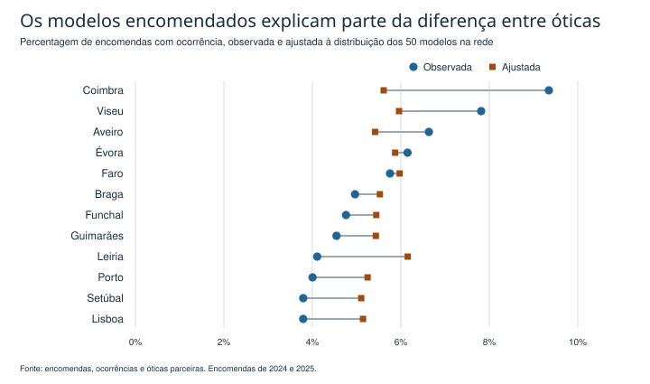
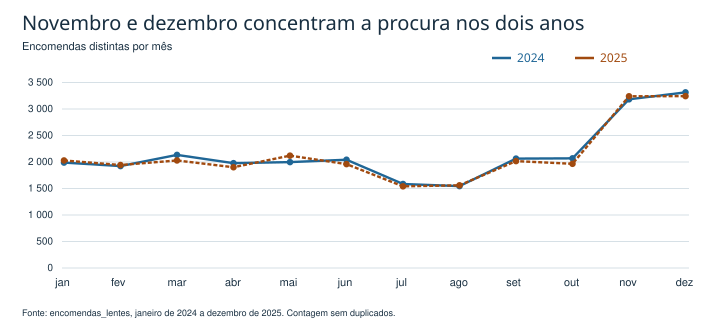

# Desafio 07 · Cadeia de lentes

**12 óticas · 50 modelos · 51 374 encomendas · janeiro de 2024 a dezembro de 2025**

Os modelos progressivos L001–L012 são a primeira prioridade para rever custos e qualidade. Representam 33,6% das encomendas e 80,8% do custo estimado das ocorrências associadas a uma encomenda. Nas encomendas de uma única lente, o custo de produção destes modelos ultrapassa a estimativa de catálogo em 52,2%. A concentração destes produtos em algumas óticas também altera a leitura do desempenho de cada parceiro.

## 1. Quanto contribui cada encomenda?

**Contribuição estimada = valor da encomenda − custo de produção registado − custo logístico − custo estimado das ocorrências associadas.**

Cada encomenda tem um registo de produção e um de logística. Quando há várias ocorrências, somam-se os respetivos custos antes de os deduzir. Uma encomenda sem ocorrência associada recebe zero nesta parcela. Os montantes estão expressos na unidade monetária dos ficheiros, que não identificam a moeda. A contribuição mede o saldo depois destes custos diretos. A contabilidade final exigiria ainda pagamentos, reembolsos efetivos, impostos e custos de estrutura.

| Cálculo para as 49 343 encomendas entregues | Montante |
|---|---:|
| Valor registado das encomendas | 11 530 672,98 |
| Custo de produção | −5 935 261,40 |
| Custo logístico | −400 379,50 |
| Custo estimado das ocorrências associadas | −465 882,57 |
| **Contribuição estimada** | **4 729 149,51** |
| **Contribuição média por encomenda entregue** | **95,84** |

**A unidade do custo de produção muda a decisão.** O cenário principal deduz o campo `custo_real` uma vez por encomenda, porque existe um registo de produção por pedido. O custo médio registado varia pouco entre encomendas entregues de uma lente (119,86) e de quatro lentes (122,97). Esta regularidade justifica verificar o significado do campo com a produção. Se o valor for unitário e se multiplicar pela quantidade, a contribuição total desce para **2 513 935,78**. O número de encomendas entregues com contribuição negativa passa de **3 805** para **4 760**.

Por exemplo, a ótica de Lisboa encomendou duas lentes L011 na encomenda **`2024/000017`**. O valor registado foi 533,60, a produção 241,04, a logística 5,22 e uma ocorrência custou aproximadamente 47,53. Deduzir a produção uma vez dá **239,81**. Deduzir 241,04 por cada uma das duas lentes dá **−1,23**. Uma ficha de custeio desta encomenda permitiria distinguir as duas interpretações.

O ficheiro de detalhe contém os dois cenários para as 51 374 encomendas. Para reproduzir o quadro financeiro, filtra a coluna `estado` por `entregue`. Nas 496 encomendas canceladas e nas 1 535 em produção, o valor da encomenda serve apenas para simulação. [Consultar a contribuição por encomenda](contribuicao-por-encomenda.csv)

### Onde rever os preços

Ao dividir o valor de cada encomenda pela quantidade e pelo preço-base do respetivo modelo, surgem dois intervalos distintos. Em 49 895 encomendas, o valor por lente ficou entre 92,0% e 100,0% do preço-base. Nas outras 1 479, ficou entre 32,6% e 69,6%. Entre as entregues, **923 de 1 429** encomendas do intervalo inferior tiveram contribuição negativa no cenário principal (64,6%), face a **2 882 de 47 914** no intervalo superior (6,0%). As 923 são um ponto de partida para verificar descontos, notas de crédito ou erros de preço. O motivo do preço praticado não consta dos ficheiros.

## 2. Que produtos e óticas merecem atenção?

### Produtos · complexidade, volume e custo real

Uma encomenda conta como **afetada** quando tem pelo menos uma ocorrência associada, mesmo que tenha várias. A taxa divide as encomendas afetadas pelo total de encomendas do grupo. Para comparar produção real com estimativa, usam-se apenas encomendas de **uma lente**. Assim, a conclusão sobre o desvio mantém-se nas duas interpretações do custo de produção.

| Grupo de modelos | Encomendas | Encomendas afetadas | Custo estimado das ocorrências associadas | Desvio da produção face ao catálogo¹ | Contribuição média por entrega² |
|---|---:|---:|---:|---:|---:|
| L001–L012 · progressivas de complexidade 4–5 | 17 259 | 1 804 (10,45%) | 394 126,10 | +52,22% | 88,50 |
| L013–L020 · progressivas de complexidade 2–3 | 7 110 | 208 (2,93%) | 17 463,34 | +3,55% | 180,24 |
| Restantes 30 modelos | 27 005 | 894 (3,31%) | 76 397,31 | +3,45% | 78,31 |

¹ Soma do custo real dividida pela soma do custo-base estimado, menos um. O cálculo abrange, respetivamente, 11 994, 4 987 e 18 965 encomendas de uma lente. Na rede, o desvio destas 35 946 encomendas é de **+25,84%**.  
² Cenário de custo de produção por encomenda. As médias abrangem, respetivamente, 16 601, 6 827 e 25 915 entregas.

As L001–L012 têm **3,24 vezes** a taxa de ocorrências dos outros 38 modelos. O padrão aparece nas 12 óticas e nos dois anos. Retirando uma ótica de cada vez, a razão mantém-se entre 3,15 e 3,30. O modelo **L001** reúne 183 encomendas afetadas em 1 488 (12,30%) e 39 953,69 de custo estimado associado. É um bom primeiro modelo para cruzar fichas de produção com os motivos das ocorrências. Os dados permitem identificar o grupo prioritário, mas a complexidade, o desenho e o processo de produção variam em conjunto. [Comparar os 50 modelos](comparacao-modelos.csv)

### Óticas · separar o volume de trabalho da taxa de ocorrências

| Ótica | Encomendas | Complexidade média³ | Encomendas afetadas | Taxa observada | Taxa ajustada ao modelo | Contribuição total das entregas² |
|---|---:|---:|---:|---:|---:|---:|
| Coimbra | 7 008 | 4,08 | 655 | 9,35% | 5,61% | 610 523,25 |
| Viseu | 4 990 | 3,41 | 390 | 7,82% | 5,96% | 441 073,96 |
| Aveiro | 4 567 | 3,33 | 303 | 6,63% | 5,42% | 423 401,13 |
| Lisboa | 6 063 | 2,42 | 230 | 3,79% | 5,14% | 564 241,42 |
| Setúbal | 6 220 | 2,49 | 236 | 3,79% | 5,11% | 586 071,29 |

³ Média da complexidade do modelo, ponderada pelo número de encomendas.

**Coimbra precisa de capacidade para tratar mais casos.** Tem 655 encomendas afetadas e o maior volume de encomendas da rede. Mas 84,9% dos seus pedidos são de modelos L001–L012, face a 33,6% na rede. Para comparar óticas em condições semelhantes, aplicou-se a cada uma a mesma distribuição nacional dos 50 modelos: para cada modelo, multiplicou-se a taxa da ótica pelo peso desse modelo nas encomendas da rede. As 12 óticas encomendaram os 50 modelos.

Com este ajuste, Coimbra passa de **9,35% para 5,61%**, perto dos **5,66%** observados na rede. O intervalo entre as 12 óticas diminui de **3,79%–9,35%** para **5,11%–6,16%**. O número de casos é adequado para dimensionar equipas. A taxa ajustada é mais informativa para comparar o serviço. Algumas combinações de ótica e modelo têm apenas 12 encomendas, pelo que diferenças pequenas na taxa ajustada devem ser interpretadas com prudência. [Comparar as 12 óticas](comparacao-oticas.csv)

### Serviço · quando reforçar capacidade e que atrasos investigar

Em novembro e dezembro entraram **6 497 encomendas em 2024** e **6 483 em 2025**, cerca de 106 por dia em ambos os anos. Em julho e agosto, a média foi de cerca de 50 por dia. A rede pode usar esta diferença para dimensionar a capacidade de fim de ano. Dois anos permitem identificar uma repetição, mas são insuficientes para estimar uma tendência de longo prazo.

Das 49 343 encomendas entregues, 20 898 chegaram na data prevista, 20 979 com um dia de atraso e **7 466 com dois a nove dias de atraso**. Este último grupo representa 15,1% das entregas e concentra **66,1% dos dias de atraso**. Todos os registos de produção terminam entre zero e dois dias antes ou na data prometida. A data logística coincide sempre com a colocação da encomenda. Para localizar a origem dos atrasos, faltam a data de expedição e a data de recolha pela transportadora.

As 4 215 respostas de satisfação têm média de **3,77**. Coimbra apresenta a média mais elevada (**4,59**), apesar do volume de ocorrências. Onze óticas têm exatamente 340 respostas cada, mesmo com volumes de encomendas muito diferentes. Só **756 respostas**, referentes a 748 encomendas distintas, têm uma ligação válida e uma data igual ou posterior à entrega. Este é o subconjunto apropriado para explorar a experiência pós-entrega. A cobertura reduzida limita a generalização.

Cada ótica dispõe de dois equipamentos de diagnóstico. Dos 24 equipamentos, 21 constam como ativos, dois em manutenção e um desativado. Os dois equipamentos ativos de Coimbra têm 2018 como último ano de manutenção registado. Vale a pena confirmar o histórico de assistência. Os dados não ligam as encomendas ao equipamento utilizado.

## 3. Que validações alteram os resultados?

Foram comparadas as oito tabelas nos dois formatos. Os CSV e JSON contêm os mesmos **162 651 registos** e **1 258 278 valores de campo**, após interpretar a vírgula decimal, os booleanos e os campos vazios dos CSV. Cada tabela entrou uma única vez na análise. O perfil técnico contém as dimensões, tipos, campos em falta, distribuições numéricas e categorias de cada ficheiro. [Consultar o perfil dos dados](perfil-dos-dados.md)

| Verificação | Resultado | Tratamento na análise |
|---|---|---|
| Unicidade das encomendas | 52 401 linhas originais e 1 027 repetições exatas. Somar a origem inflacionaria o valor em 241 688,63. | Retiraram-se apenas as repetições exatas na cópia de análise. Ficaram 51 374 códigos únicos. |
| Formatos dos códigos | Há 17 125 referências do tipo `ENC000001`, 17 125 do tipo `2024/000002` e 17 124 do tipo `ENC-2024-000003`. Quando o código contém ano, este coincide sempre com o ano de colocação. | Usou-se o código integral para ligar tabelas. Todos os códigos de ótica e lente preenchidos existem nos respetivos catálogos. |
| Produção, logística e custos | Cada encomenda tem exatamente uma linha de produção e uma de logística. Todos os valores de encomenda, custos de produção, custos-base, custos logísticos e custos estimados de ocorrências são positivos. | O teste de positividade deteta valores impossíveis. O confronto com o catálogo nas encomendas de uma lente identifica custos positivos que merecem revisão. |
| Ocorrências sem encomenda | 185 das 3 201 ocorrências (5,78%) têm uma referência `ENC-9999-…` sem correspondência. Custam 29 736,69 no total. | As 185 integram o total do registo de ocorrências e ficam fora da contribuição individual. As 3 016 ocorrências associadas correspondem a 2 906 encomendas. |
| Reconciliação do custo das ocorrências | Total de 517 723,44, dos quais 487 986,75 associados a encomendas e 29 736,69 por associar. | Nos 3 016 eventos associados, tanto a ótica como o modelo coincidem com a encomenda. A soma dos dois grupos reconcilia o total do registo. |
| Datas e estados | 1 383 encomendas distintas têm data de colocação em dia/mês/ano e 49 991 em formato ISO. As 2 031 sem data real correspondem às canceladas ou em produção. Todas estas têm data de fim de produção e custo logístico. | Interpretaram-se explicitamente os dois formatos. As taxas de atraso usam só entregas com data real, incluindo entregas em janeiro de 2026. Validar os estados antes de estimar a carteira pendente. |
| Quantidades e datas das ocorrências | Em 305 eventos associados, a quantidade afetada excede a encomendada. Em 402 das 860 devoluções associadas a encomendas entregues, o registo antecede a entrega. | A taxa usa encomendas distintas afetadas. Confirmar a unidade da quantidade e o momento que a data de registo representa. |
| Motivos, resoluções e satisfação | Faltam 377 motivos e 564 resoluções de ocorrência. Há 2 539 respostas de satisfação sem encomenda e 868 respostas com data anterior à colocação da encomenda associada. | Conservar a categoria desconhecida e filtrar as datas antes de relacionar satisfação com uma entrega. |

As **devoluções** têm o maior custo estimado total (194 739,58 em 952 registos), seguidas do **retrabalho** (189 858,60 em 1 494). As **substituições** têm o maior custo médio por evento (261,82 em 460 registos). Mesmo contando as 185 ocorrências sem encomenda pelo modelo nelas indicado, a parcela de custo dos modelos L001–L012 mantém-se em **80,7%**. A prioridade de investigação resiste, portanto, ao problema de associação. [Consultar as 185 ocorrências por reconciliar](ocorrencias-sem-encomenda.csv)

## Decisões propostas

1. **Produção e qualidade.** Rever fichas das L001–L012, começando pela L001. Nas encomendas de uma lente, confrontar o custo real e a estimativa com tempos de produção e motivos confirmados de retrabalho.
2. **Preços e contribuição.** Confirmar se a produção é custeada por lente ou por encomenda. Depois, rever as 923 entregas do intervalo de preço inferior com contribuição negativa no cenário principal.
3. **Serviço às óticas.** Usar o número de casos para distribuir trabalho e a taxa ajustada por modelo para comparar parceiros. Preparar a capacidade de novembro e dezembro e acompanhar separadamente as entregas com pelo menos dois dias de atraso.
4. **Reconciliação.** Começar pelos 29 736,69 de ocorrências sem encomenda. Acrescentar datas de expedição e recolha e esclarecer o significado de «fim de produção» nas encomendas ainda assinaladas como pendentes.
